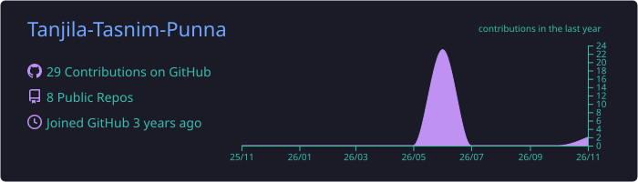
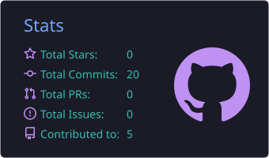
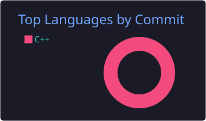

<!-- Animated header -->

 

---

##  About me

I build AI products for real problems in Bangladesh, from automating Outcome-Based Education in universities to finding garment defects on RMG factory floors and identifying medicinal plants from a single leaf.

- 🎤 Presented **OBE Eye** and **Shilpo AI ERP** at the **Bangladesh AI Business Summit 2026**
- 🌿 Published **MediLeaf-23**, an open dataset of 9,817 leaf images of 23 medicinal plants ([Mendeley Data](https://doi.org/10.17632/w9nnvf3t6p.1))
- 📄 **IEEE COMPAS 2026**: *RiceNetMSAF*, a multi-scale attention fusion network for rice variety classification (accepted)
- 🏆 Startup World Cup Bangladesh 2026 semi-finalist · Dean's List (Summer & Fall 2025) · CGPA **3.91/4.00**
- 🌱 Currently learning: Machine Learning (NASA Government Training Program, 2026)

---

##  Featured projects

<table>
<tr>
<td width="50%" valign="top">

### 👁️ OBE Eye
**AI for Outcome-Based Education**

Automates the OBE workflow for DIU's CSE department: compliance checks on question papers, CO/PO attainment from student marks, a CQI dashboard, and AI study recommendations for students.

</td>
<td width="50%" valign="top">

### 🧵 Shilpo AI ERP
**AI for Bangladesh's RMG industry · Co-Founder**

An ERP for garment factories with AI defect detection, production tracking and traceability. I built the defect-detection module and the offline ONNX inference pipeline for factory deployment.

</td>
</tr>
<tr>
<td width="50%" valign="top">

### 🌿 MediLeaf-23 (dataset)
**Medicinal plant leaf images from Bangladesh**

9,817 leaf photos across 23 medicinal plants (Neem, Tulsi, Amla, Arjun, Moringa and more), collected at DIU and de-duplicated by SHA-256 hash and visual check. Released under CC BY 4.0.

</td>
<td width="50%" valign="top">

### 🌾 RiceNetMSAF (research)
**Fine-grained rice variety classification**

A leakage-audited, statistically validated multi-scale attention fusion network. Accepted for presentation and publication at *IEEE COMPAS 2026*.

</td>
</tr>
<tr>
<td width="50%" valign="top">

### 🐄 খামারি (Khamari)
**Dairy farm management in Bangla**

Tracks cattle, milk production and sales, feed, expenses, salaries and health alerts, with a monthly profit/loss report for each cow.

</td>
<td width="50%" valign="top">

### ⚙️ [Educational Visual Compiler](https://github.com/Tanjila-Tasnim-Punna/Compiler_project_visual)
**See how a compiler works, phase by phase**

Shows tokens, the symbol table, a D3 parse tree, three-address code and assembly for your code, right in the browser.

</td>
</tr>
</table>

<b>More projects</b>

 

- 🏙️ [City View (OpenGL)](https://github.com/Tanjila-Tasnim-Punna/City_View_CG): an animated city with a metro, cars and clouds
- 🖥️ [OpenGL Workstation Scene](https://github.com/Tanjila-Tasnim-Punna/Opengl-Workstation-Scene): a 2D desk scene using the midpoint circle algorithm
- 🦋 [Butterfly (OpenGL)](https://github.com/Tanjila-Tasnim-Punna/computer-graphics-butterfly-opengl)
- 🚌 [DIU Transport Management](https://github.com/Tanjila-Tasnim-Punna/DIU-transport-info): a transport portal homepage
- 🏦 Bank Management System (Java) · 🎫 Bus Reservation System (Java) · 🔐 Smart Door Lock (RFID, IoT)

---

##  Tech stack

  

  

---

##  Highlights

| 🏅 | |
|---|---|
| 🎤 | **Bangladesh AI Business Summit 2026**: presenter (OBE Eye, Shilpo AI ERP) |
| 🚀 | **Startup World Cup Bangladesh 2026**: semi-finalist |
| 🥉 | **2nd Runner-Up**, Idea Presentation Competition (CSAD 2026), Cyber Threats & Public Safety |
| 📄 | **IEEE COMPAS 2026**: paper accepted |
| 🌿 | **MediLeaf-23**: public dataset on Mendeley Data |
| 🎓 | **Dean's List**, Summer 2025 & Fall 2025 |
| 💡 | Bangladesh ICT & Innovation Award 2026 · UNDP Legal AI Hackathon · AI Project Competition 2026 |
| 🛡️ | Assistant Joint Secretary (Design), DIU Cyber Security Club · Member, DIU IoT Lab |

---

##  GitHub stats

<picture>
  <source media="(prefers-color-scheme: dark)" srcset="https://raw.githubusercontent.com/Tanjila-Tasnim-Punna/Tanjila-Tasnim-Punna/output/github-snake-dark.svg" />
  
</picture>

